<!-- hero:start -->

<a href="https://raw.githubusercontent.com/soubhik-biswas/soubhik-biswas/main/panels/hero.svg?v=269a6962d2eb"><picture><source media="(max-width: 600px)" srcset="https://raw.githubusercontent.com/soubhik-biswas/soubhik-biswas/main/panels/hero-mobile.svg?v=103e577be39c" /></picture></a>

<!-- hero:end -->

I lead frontend engineering at **Deccan AI**, building shared design systems, schema-driven forms and complex product interfaces. Previously **SDE-I at AccioJob**, working on contest platforms, browser-based project editing and coding assessments.

[Products](#products) · [Engineering pulse](#engineering-pulse) · [Code](#code) · [How I build](#how-i-build) · [Connect](#connect)

## Products

Six things I have designed and built. Each card opens the product.

<!-- projects:start -->

<a href="https://passlore.com/"><picture><source media="(max-width: 600px)" srcset="https://raw.githubusercontent.com/soubhik-biswas/soubhik-biswas/main/panels/project-passlore-mobile.svg?v=b3835d38e2e0" /></picture></a>
<a href="https://awaketab.com/"><picture><source media="(max-width: 600px)" srcset="https://raw.githubusercontent.com/soubhik-biswas/soubhik-biswas/main/panels/project-awaketab-mobile.svg?v=ca75516cd49f" /></picture></a>
<a href="https://shareroom.app/"><picture><source media="(max-width: 600px)" srcset="https://raw.githubusercontent.com/soubhik-biswas/soubhik-biswas/main/panels/project-shareroom-mobile.svg?v=8720b47ef272" /></picture></a>
<a href="https://marketplace.visualstudio.com/items?itemName=SoubhikBiswas-gitHub.oibuddy"><picture><source media="(max-width: 600px)" srcset="https://raw.githubusercontent.com/soubhik-biswas/soubhik-biswas/main/panels/project-oibuddy-mobile.svg?v=e9869854296d" /></picture></a>
<a href="https://github.com/soubhik-biswas/prismwink"><picture><source media="(max-width: 600px)" srcset="https://raw.githubusercontent.com/soubhik-biswas/soubhik-biswas/main/panels/project-prismwink-mobile.svg?v=9599d9b43c8f" /></picture></a>
<a href="https://github.com/soubhik-biswas/bucketpeek"><picture><source media="(max-width: 600px)" srcset="https://raw.githubusercontent.com/soubhik-biswas/soubhik-biswas/main/panels/project-bucketpeek-mobile.svg?v=776764e6b659" /></picture></a>

<!-- projects:end -->

## Engineering pulse

<!-- pulse:start -->

<a href="https://raw.githubusercontent.com/soubhik-biswas/soubhik-biswas/main/panels/pulse.svg?v=466343d924c4"><picture><source media="(max-width: 600px)" srcset="https://raw.githubusercontent.com/soubhik-biswas/soubhik-biswas/main/panels/pulse-mobile.svg?v=4d97ead82e84" /></picture></a>
<a href="https://raw.githubusercontent.com/soubhik-biswas/soubhik-biswas/main/panels/rhythm.svg?v=c0bb708c431b"><picture><source media="(max-width: 600px)" srcset="https://raw.githubusercontent.com/soubhik-biswas/soubhik-biswas/main/panels/rhythm-mobile.svg?v=68a035f3bb30" /></picture></a>

<!-- pulse:end -->

Contribution and repository data refresh every day. Open any chart to hover over a bar, bubble or block for its exact numbers.

<details>
<summary><b>Month by month</b></summary>
<br />

<!-- months:start -->

<a href="https://raw.githubusercontent.com/soubhik-biswas/soubhik-biswas/main/panels/months.svg?v=374829554b46"><picture><source media="(max-width: 600px)" srcset="https://raw.githubusercontent.com/soubhik-biswas/soubhik-biswas/main/panels/months-mobile.svg?v=5b7b5a9252c0" /></picture></a>

| Month | Contributions | Active days | Commits | Lines added | Lines removed |
| --- | ---: | ---: | ---: | ---: | ---: |
| November 2026 | 1,976 | 12 | 48 | 10,041 | 230,459 |
| October 2026 | 1,409 | 13 | 342 | 485,937 | 188,173 |
| September 2026 | 435 | 8 | 424 | 669,447 | 366,006 |
| August 2026 | 0 | 0 | 0 | 0 | 0 |
| July 2026 | 0 | 0 | 0 | 0 | 0 |
| June 2026 | 0 | 0 | 0 | 0 | 0 |
| May 2026 | 32 | 2 | 0 | 0 | 0 |
| April 2026 | 37 | 6 | 19 | 15,319 | 4,593 |
| March 2026 | 0 | 0 | 0 | 0 | 0 |
| February 2026 | 0 | 0 | 0 | 0 | 0 |
| January 2026 | 24 | 3 | 0 | 0 | 0 |
| December 2025 | 0 | 0 | 0 | 0 | 0 |
| November 2025 | 0 | 0 | 0 | 0 | 0 |

<!-- months:end -->

</details>

<details>
<summary><b>Day by day</b></summary>
<br />

<!-- activity-data:start -->

| Public GitHub activity | Contributions | Active days |
| --- | ---: | ---: |
| 2026-10-14 to 2026-11-12 | **3,383** | **24 / 30** |
| 2026-09-14 to 2026-10-13 | 415 | 6 / 30 |

**3,913** contributions across the calendar, **44** active days, **23**-day longest streak.

<!-- activity-data:end -->

<!-- daily-activity:start -->

Days with no contributions are left out. Commit and line counts cover the default branches of 9 owned public repositories from 2025-11-09 through 2026-11-12 (UTC). A dash marks dates outside that snapshot.

<details open>
<summary>November 2026: 1,976 contributions</summary>

| Date | Contributions | Commits | Lines added | Lines removed |
| --- | ---: | ---: | ---: | ---: |
| Nov 1 | 1 | 1 | 25 | 55 |
| Nov 2 | 26 | 1 | 18 | 13 |
| Nov 3 | 27 | 1 | 17 | 12 |
| Nov 4 | 34 | 0 | 0 | 0 |
| Nov 5 | 34 | 1 | 23 | 13 |
| Nov 6 | 4 | 1 | 17 | 12 |
| Nov 7 | 166 | 2 | 520 | 373 |
| Nov 8 | 259 | 1 | 26 | 56 |
| Nov 9 | 440 | 1 | 19 | 14 |
| Nov 10 | 34 | 1 | 28 | 23 |
| Nov 11 | 10 | 1 | 17 | 12 |
| Nov 12 | 941 | 37 | 9,331 | 229,876 |

</details>

<details>
<summary>October 2026: 1,409 contributions</summary>

| Date | Contributions | Commits | Lines added | Lines removed |
| --- | ---: | ---: | ---: | ---: |
| Oct 9 | 2 | 0 | 0 | 0 |
| Oct 18 | 43 | 0 | 0 | 0 |
| Oct 21 | 55 | 7 | 249 | 77 |
| Oct 22 | 75 | 28 | 18,180 | 1,110 |
| Oct 23 | 116 | 18 | 4,237 | 3,851 |
| Oct 24 | 188 | 0 | 0 | 0 |
| Oct 25 | 262 | 0 | 0 | 0 |
| Oct 26 | 22 | 0 | 0 | 0 |
| Oct 27 | 1 | 0 | 0 | 0 |
| Oct 28 | 161 | 0 | 0 | 0 |
| Oct 29 | 66 | 4 | 10,691 | 8,627 |
| Oct 30 | 206 | 187 | 259,860 | 38,863 |
| Oct 31 | 212 | 98 | 192,720 | 135,645 |

</details>

<details>
<summary>September 2026: 435 contributions</summary>

| Date | Contributions | Commits | Lines added | Lines removed |
| --- | ---: | ---: | ---: | ---: |
| Sep 9 | 8 | 0 | 0 | 0 |
| Sep 12 | 13 | 0 | 0 | 0 |
| Sep 13 | 1 | 1 | 3 | 12 |
| Sep 25 | 10 | 3 | 68,853 | 0 |
| Sep 26 | 84 | 83 | 150,028 | 4,856 |
| Sep 27 | 105 | 250 | 348,458 | 342,089 |
| Sep 28 | 155 | 66 | 61,890 | 18,433 |
| Sep 29 | 59 | 0 | 0 | 0 |

</details>

<details>
<summary>May 2026: 32 contributions</summary>

| Date | Contributions | Commits | Lines added | Lines removed |
| --- | ---: | ---: | ---: | ---: |
| May 1 | 9 | 0 | 0 | 0 |
| May 2 | 23 | 0 | 0 | 0 |

</details>

<details>
<summary>April 2026: 37 contributions</summary>

| Date | Contributions | Commits | Lines added | Lines removed |
| --- | ---: | ---: | ---: | ---: |
| Apr 3 | 8 | 12 | 14,522 | 2,048 |
| Apr 4 | 12 | 7 | 797 | 2,545 |
| Apr 25 | 2 | 0 | 0 | 0 |
| Apr 26 | 11 | 0 | 0 | 0 |
| Apr 29 | 3 | 0 | 0 | 0 |
| Apr 30 | 1 | 0 | 0 | 0 |

</details>

<details>
<summary>January 2026: 24 contributions</summary>

| Date | Contributions | Commits | Lines added | Lines removed |
| --- | ---: | ---: | ---: | ---: |
| Jan 23 | 10 | 0 | 0 | 0 |
| Jan 24 | 2 | 0 | 0 | 0 |
| Jan 25 | 12 | 0 | 0 | 0 |

</details>

<!-- daily-activity:end -->

</details>

## Code

<!-- codebase:start -->

<a href="https://raw.githubusercontent.com/soubhik-biswas/soubhik-biswas/main/panels/codebase.svg?v=f8d4242b2570"><picture><source media="(max-width: 600px)" srcset="https://raw.githubusercontent.com/soubhik-biswas/soubhik-biswas/main/panels/codebase-mobile.svg?v=d124568324a4" /></picture></a>

<!-- codebase:end -->

<!-- repository-data:start -->

**65** owned repositories as of 2026-11-13 IST: **9** public and **56** private. The charts above cover the public ones.

<!-- repository-data:end -->

## How I build

<!-- craft:start -->

<a href="https://raw.githubusercontent.com/soubhik-biswas/soubhik-biswas/main/panels/craft.svg?v=6e7f67c995f1"><picture><source media="(max-width: 600px)" srcset="https://raw.githubusercontent.com/soubhik-biswas/soubhik-biswas/main/panels/craft-mobile.svg?v=9bb34ce730b9" /></picture></a>

<!-- craft:end -->

My work connects reusable React components, configurable themes and interactive documentation with the details of each product. That includes shared validation, coding interfaces, authentication, browser extensions and resumable uploads.

<!-- stack:start -->

<a href="https://raw.githubusercontent.com/soubhik-biswas/soubhik-biswas/main/panels/stack.svg?v=4fc611ae6d6f"><picture><source media="(max-width: 600px)" srcset="https://raw.githubusercontent.com/soubhik-biswas/soubhik-biswas/main/panels/stack-mobile.svg?v=ea1ff3e9c031" /></picture></a>

<!-- stack:end -->

## Connect

<!-- connect:start -->

<a href="https://www.linkedin.com/in/biswas-soubhik/"><picture><source media="(max-width: 600px)" srcset="https://raw.githubusercontent.com/soubhik-biswas/soubhik-biswas/main/panels/connect-mobile.svg?v=2c52f0916dd0" /></picture></a>

<!-- connect:end -->

[Connect on LinkedIn](https://www.linkedin.com/in/biswas-soubhik/) · [Browse my repositories](https://github.com/soubhik-biswas?tab=repositories)

I live in Kolkata / Krishnanagar, India. Deccan AI's office is in Hyderabad, Telangana.

<details>
<summary>Data sources and methodology</summary>
<br />

The [GitHub contribution calendar](https://github.com/users/soubhik-biswas/contributions) supplies the daily counts visible to signed-out visitors. The daily chart, weekly rhythm and weekly bars cover the latest 91 displayed days, and each week is seven consecutive displayed days. The two 30-day periods end on the latest calendar date and 30 days earlier. The latest day may be partial. A day counts as active when its contribution count is above zero. The 7-day average is the mean of a day and the six days before it. Streaks are bounded by the displayed calendar. Contributions can include several [types of activity](https://docs.github.com/en/account-and-profile/reference/profile-contributions-reference).

Language shares use [GitHub's repository language API](https://docs.github.com/en/rest/repos/repos#list-repository-languages) and cover owned public repositories, excluding forks. The treemap sizes each repository by its detected code bytes, and the strip along the bottom of each block shows that repository's own language mix. Detected bytes describe repository composition. The repository total comes from the dated [owner inventory snapshot](assets/repository-inventory.json).

Commit totals use the [public commit snapshot](assets/commit-activity.json). It counts primary-authored commits on owned public default branches by UTC author date. Lines added and removed are the totals GitHub reports for those commit diffs, so generated and vendored files are included.

Every panel is a self-contained SVG with a narrow-screen layout, a text description and reduced-motion support. A [daily workflow](https://github.com/soubhik-biswas/soubhik-biswas/actions/workflows/profile.yml) refreshes the [public data snapshot](assets/public-data.json) and rebuilds the panels.

Update profile details in `profile.json` and projects in `assets/projects.json`, keep the prose in sync, then run:

```sh
python3 scripts/update-data.py
python3 scripts/render-profile.py
python3 scripts/check-profile.py
python3 -m unittest discover -s scripts -p 'test_*.py'
```

[Asset sources and licenses](assets/NOTICES.md) · [Product brief](PRODUCT.md) · [Visual system](DESIGN.md)

</details>
