# Soubhik Biswas · Lead Frontend Engineer

<picture>
  <source media="(max-width: 600px)" srcset="https://raw.githubusercontent.com/soubhik-biswas/soubhik-biswas/main/profile-overview-mobile.svg?v=8e6f4719578d" />
  
</picture>

I lead frontend engineering at **Deccan AI**, building shared design systems, schema-driven forms and complex product interfaces. Previously **SDE-I at AccioJob**, working on contest platforms, browser-based project editing and coding assessments.

[Projects](#selected-projects) · [Contribution trends](#contribution-trends) · [Calendar and daily activity](#contribution-calendar) · [Repository counts and languages](#code-across-projects)

**Home:** Kolkata / Krishnanagar, India · **Company office:** Hyderabad, Telangana<br />
[LinkedIn](https://www.linkedin.com/in/biswas-soubhik/) · [Public repositories](https://github.com/soubhik-biswas?tab=repositories)

## Selected projects

<!-- featured-projects:start -->

| Project | What it does |
| --- | --- |
| [Passlore](https://passlore.com/) | Generates passwords, passphrases, and PINs directly in the browser. Choose a recipe for a password manager, Wi-Fi, a PIN, or a site with specific rules. |
| [AwakeTab](https://awaketab.com/) | Keeps the display awake during a timed browser session. Built around the Screen Wake Lock API, with clock faces, timers, and an embeddable widget. |
| [Shareroom](https://shareroom.app/) | A shared room for working together in the browser. Open a room to share and preview work from one link. |

<!-- featured-projects:end -->

## Contribution trends

<picture>
  <source media="(max-width: 600px)" srcset="https://raw.githubusercontent.com/soubhik-biswas/soubhik-biswas/main/activity-mobile.svg?v=000e9cf7122c" />
  
</picture>

<!-- activity-data:start -->

| Public GitHub activity | Contributions | Active days |
| --- | ---: | ---: |
| 2026-10-14 to 2026-11-12 | **3,383** | **24 / 30** |
| 2026-09-14 to 2026-10-13 | 415 | 6 / 30 |

**3,913** contributions across the displayed calendar · **44** active days · **23**-day longest streak

<!-- activity-data:end -->

## Contribution calendar

<picture>
  <source media="(max-width: 600px)" srcset="https://raw.githubusercontent.com/soubhik-biswas/soubhik-biswas/main/contribution-calendar-mobile.svg?v=3fbdd66fc3b1" />
  
</picture>

<!-- daily-activity:start -->

Bold numbers show GitHub contributions. Bars scale to the busiest day of each month.

Commit and line counts cover the default branches of 9 owned public repositories from 2025-11-09 through 2026-11-12 (UTC). A dash marks dates outside that snapshot.

<details open>
<summary>November 2026 · 1,976 contributions</summary>

| Mon | Tue | Wed | Thu | Fri | Sat | Sun |
| --- | --- | --- | --- | --- | --- | --- |
|  |  |  |  |  |  | **1**<br>▮<br><sub>1</sub> |
| **26**<br>▮<br><sub>2</sub> | **27**<br>▮<br><sub>3</sub> | **34**<br>▮<br><sub>4</sub> | **34**<br>▮<br><sub>5</sub> | **4**<br>▮<br><sub>6</sub> | **166**<br>▮<br><sub>7</sub> | **259**<br>▮▮<br><sub>8</sub> |
| **440**<br>▮▮▮<br><sub>9</sub> | **34**<br>▮<br><sub>10</sub> | **10**<br>▮<br><sub>11</sub> | **941**<br>▮▮▮▮▮<br><sub>12</sub> |  |  |  |
|  |  |  |  |  |  |  |
|  |  |  |  |  |  |  |
|  |  |  |  |  |  |  |

| Date | Contributions | Commits | Lines added | Lines removed |
| --- | ---: | ---: | ---: | ---: |
| Nov 1 | 1 | 1 | 25 | 55 |
| Nov 2 | 26 | 1 | 18 | 13 |
| Nov 3 | 27 | 1 | 17 | 12 |
| Nov 4 | 34 | 0 | 0 | 0 |
| Nov 5 | 34 | 1 | 23 | 13 |
| Nov 6 | 4 | 1 | 17 | 12 |
| Nov 7 | 166 | 2 | 520 | 373 |
| Nov 8 | 259 | 1 | 26 | 56 |
| Nov 9 | 440 | 1 | 19 | 14 |
| Nov 10 | 34 | 1 | 28 | 23 |
| Nov 11 | 10 | 1 | 17 | 12 |
| Nov 12 | 941 | 37 | 9,331 | 229,876 |

</details>

<details>
<summary>October 2026 · 1,409 contributions</summary>

| Mon | Tue | Wed | Thu | Fri | Sat | Sun |
| --- | --- | --- | --- | --- | --- | --- |
|  |  |  | <br><br><sub>1</sub> | <br><br><sub>2</sub> | <br><br><sub>3</sub> | <br><br><sub>4</sub> |
| <br><br><sub>5</sub> | <br><br><sub>6</sub> | <br><br><sub>7</sub> | <br><br><sub>8</sub> | **2**<br>▮<br><sub>9</sub> | <br><br><sub>10</sub> | <br><br><sub>11</sub> |
| <br><br><sub>12</sub> | <br><br><sub>13</sub> | <br><br><sub>14</sub> | <br><br><sub>15</sub> | <br><br><sub>16</sub> | <br><br><sub>17</sub> | **43**<br>▮<br><sub>18</sub> |
| <br><br><sub>19</sub> | <br><br><sub>20</sub> | **55**<br>▮▮<br><sub>21</sub> | **75**<br>▮▮<br><sub>22</sub> | **116**<br>▮▮▮<br><sub>23</sub> | **188**<br>▮▮▮▮<br><sub>24</sub> | **262**<br>▮▮▮▮▮<br><sub>25</sub> |
| **22**<br>▮<br><sub>26</sub> | **1**<br>▮<br><sub>27</sub> | **161**<br>▮▮▮▮<br><sub>28</sub> | **66**<br>▮▮<br><sub>29</sub> | **206**<br>▮▮▮▮<br><sub>30</sub> | **212**<br>▮▮▮▮▮<br><sub>31</sub> |  |

| Date | Contributions | Commits | Lines added | Lines removed |
| --- | ---: | ---: | ---: | ---: |
| Oct 1 | 0 | 0 | 0 | 0 |
| Oct 2 | 0 | 0 | 0 | 0 |
| Oct 3 | 0 | 0 | 0 | 0 |
| Oct 4 | 0 | 0 | 0 | 0 |
| Oct 5 | 0 | 0 | 0 | 0 |
| Oct 6 | 0 | 0 | 0 | 0 |
| Oct 7 | 0 | 0 | 0 | 0 |
| Oct 8 | 0 | 0 | 0 | 0 |
| Oct 9 | 2 | 0 | 0 | 0 |
| Oct 10 | 0 | 0 | 0 | 0 |
| Oct 11 | 0 | 0 | 0 | 0 |
| Oct 12 | 0 | 0 | 0 | 0 |
| Oct 13 | 0 | 0 | 0 | 0 |
| Oct 14 | 0 | 0 | 0 | 0 |
| Oct 15 | 0 | 0 | 0 | 0 |
| Oct 16 | 0 | 0 | 0 | 0 |
| Oct 17 | 0 | 0 | 0 | 0 |
| Oct 18 | 43 | 0 | 0 | 0 |
| Oct 19 | 0 | 0 | 0 | 0 |
| Oct 20 | 0 | 0 | 0 | 0 |
| Oct 21 | 55 | 7 | 249 | 77 |
| Oct 22 | 75 | 28 | 18,180 | 1,110 |
| Oct 23 | 116 | 18 | 4,237 | 3,851 |
| Oct 24 | 188 | 0 | 0 | 0 |
| Oct 25 | 262 | 0 | 0 | 0 |
| Oct 26 | 22 | 0 | 0 | 0 |
| Oct 27 | 1 | 0 | 0 | 0 |
| Oct 28 | 161 | 0 | 0 | 0 |
| Oct 29 | 66 | 4 | 10,691 | 8,627 |
| Oct 30 | 206 | 187 | 259,860 | 38,863 |
| Oct 31 | 212 | 98 | 192,720 | 135,645 |

</details>

<details>
<summary>September 2026 · 435 contributions</summary>

| Mon | Tue | Wed | Thu | Fri | Sat | Sun |
| --- | --- | --- | --- | --- | --- | --- |
|  | <br><br><sub>1</sub> | <br><br><sub>2</sub> | <br><br><sub>3</sub> | <br><br><sub>4</sub> | <br><br><sub>5</sub> | <br><br><sub>6</sub> |
| <br><br><sub>7</sub> | <br><br><sub>8</sub> | **8**<br>▮<br><sub>9</sub> | <br><br><sub>10</sub> | <br><br><sub>11</sub> | **13**<br>▮<br><sub>12</sub> | **1**<br>▮<br><sub>13</sub> |
| <br><br><sub>14</sub> | <br><br><sub>15</sub> | <br><br><sub>16</sub> | <br><br><sub>17</sub> | <br><br><sub>18</sub> | <br><br><sub>19</sub> | <br><br><sub>20</sub> |
| <br><br><sub>21</sub> | <br><br><sub>22</sub> | <br><br><sub>23</sub> | <br><br><sub>24</sub> | **10**<br>▮<br><sub>25</sub> | **84**<br>▮▮▮<br><sub>26</sub> | **105**<br>▮▮▮▮<br><sub>27</sub> |
| **155**<br>▮▮▮▮▮<br><sub>28</sub> | **59**<br>▮▮<br><sub>29</sub> | <br><br><sub>30</sub> |  |  |  |  |

| Date | Contributions | Commits | Lines added | Lines removed |
| --- | ---: | ---: | ---: | ---: |
| Sep 1 | 0 | 0 | 0 | 0 |
| Sep 2 | 0 | 0 | 0 | 0 |
| Sep 3 | 0 | 0 | 0 | 0 |
| Sep 4 | 0 | 0 | 0 | 0 |
| Sep 5 | 0 | 0 | 0 | 0 |
| Sep 6 | 0 | 0 | 0 | 0 |
| Sep 7 | 0 | 0 | 0 | 0 |
| Sep 8 | 0 | 8 | 18,331 | 104 |
| Sep 9 | 8 | 0 | 0 | 0 |
| Sep 10 | 0 | 0 | 0 | 0 |
| Sep 11 | 0 | 13 | 21,884 | 512 |
| Sep 12 | 13 | 0 | 0 | 0 |
| Sep 13 | 1 | 1 | 3 | 12 |
| Sep 14 | 0 | 0 | 0 | 0 |
| Sep 15 | 0 | 0 | 0 | 0 |
| Sep 16 | 0 | 0 | 0 | 0 |
| Sep 17 | 0 | 0 | 0 | 0 |
| Sep 18 | 0 | 0 | 0 | 0 |
| Sep 19 | 0 | 0 | 0 | 0 |
| Sep 20 | 0 | 0 | 0 | 0 |
| Sep 21 | 0 | 0 | 0 | 0 |
| Sep 22 | 0 | 0 | 0 | 0 |
| Sep 23 | 0 | 0 | 0 | 0 |
| Sep 24 | 0 | 0 | 0 | 0 |
| Sep 25 | 10 | 3 | 68,853 | 0 |
| Sep 26 | 84 | 83 | 150,028 | 4,856 |
| Sep 27 | 105 | 250 | 348,458 | 342,089 |
| Sep 28 | 155 | 66 | 61,890 | 18,433 |
| Sep 29 | 59 | 0 | 0 | 0 |
| Sep 30 | 0 | 0 | 0 | 0 |

</details>

<details>
<summary>August 2026 · 0 contributions</summary>

| Mon | Tue | Wed | Thu | Fri | Sat | Sun |
| --- | --- | --- | --- | --- | --- | --- |
|  |  |  |  |  | <br><br><sub>1</sub> | <br><br><sub>2</sub> |
| <br><br><sub>3</sub> | <br><br><sub>4</sub> | <br><br><sub>5</sub> | <br><br><sub>6</sub> | <br><br><sub>7</sub> | <br><br><sub>8</sub> | <br><br><sub>9</sub> |
| <br><br><sub>10</sub> | <br><br><sub>11</sub> | <br><br><sub>12</sub> | <br><br><sub>13</sub> | <br><br><sub>14</sub> | <br><br><sub>15</sub> | <br><br><sub>16</sub> |
| <br><br><sub>17</sub> | <br><br><sub>18</sub> | <br><br><sub>19</sub> | <br><br><sub>20</sub> | <br><br><sub>21</sub> | <br><br><sub>22</sub> | <br><br><sub>23</sub> |
| <br><br><sub>24</sub> | <br><br><sub>25</sub> | <br><br><sub>26</sub> | <br><br><sub>27</sub> | <br><br><sub>28</sub> | <br><br><sub>29</sub> | <br><br><sub>30</sub> |
| <br><br><sub>31</sub> |  |  |  |  |  |  |

| Date | Contributions | Commits | Lines added | Lines removed |
| --- | ---: | ---: | ---: | ---: |
| Aug 1 | 0 | 0 | 0 | 0 |
| Aug 2 | 0 | 0 | 0 | 0 |
| Aug 3 | 0 | 0 | 0 | 0 |
| Aug 4 | 0 | 0 | 0 | 0 |
| Aug 5 | 0 | 0 | 0 | 0 |
| Aug 6 | 0 | 0 | 0 | 0 |
| Aug 7 | 0 | 0 | 0 | 0 |
| Aug 8 | 0 | 0 | 0 | 0 |
| Aug 9 | 0 | 0 | 0 | 0 |
| Aug 10 | 0 | 0 | 0 | 0 |
| Aug 11 | 0 | 0 | 0 | 0 |
| Aug 12 | 0 | 0 | 0 | 0 |
| Aug 13 | 0 | 0 | 0 | 0 |
| Aug 14 | 0 | 0 | 0 | 0 |
| Aug 15 | 0 | 0 | 0 | 0 |
| Aug 16 | 0 | 0 | 0 | 0 |
| Aug 17 | 0 | 0 | 0 | 0 |
| Aug 18 | 0 | 0 | 0 | 0 |
| Aug 19 | 0 | 0 | 0 | 0 |
| Aug 20 | 0 | 0 | 0 | 0 |
| Aug 21 | 0 | 0 | 0 | 0 |
| Aug 22 | 0 | 0 | 0 | 0 |
| Aug 23 | 0 | 0 | 0 | 0 |
| Aug 24 | 0 | 0 | 0 | 0 |
| Aug 25 | 0 | 0 | 0 | 0 |
| Aug 26 | 0 | 0 | 0 | 0 |
| Aug 27 | 0 | 0 | 0 | 0 |
| Aug 28 | 0 | 0 | 0 | 0 |
| Aug 29 | 0 | 0 | 0 | 0 |
| Aug 30 | 0 | 0 | 0 | 0 |
| Aug 31 | 0 | 0 | 0 | 0 |

</details>

<details>
<summary>July 2026 · 0 contributions</summary>

| Mon | Tue | Wed | Thu | Fri | Sat | Sun |
| --- | --- | --- | --- | --- | --- | --- |
|  |  | <br><br><sub>1</sub> | <br><br><sub>2</sub> | <br><br><sub>3</sub> | <br><br><sub>4</sub> | <br><br><sub>5</sub> |
| <br><br><sub>6</sub> | <br><br><sub>7</sub> | <br><br><sub>8</sub> | <br><br><sub>9</sub> | <br><br><sub>10</sub> | <br><br><sub>11</sub> | <br><br><sub>12</sub> |
| <br><br><sub>13</sub> | <br><br><sub>14</sub> | <br><br><sub>15</sub> | <br><br><sub>16</sub> | <br><br><sub>17</sub> | <br><br><sub>18</sub> | <br><br><sub>19</sub> |
| <br><br><sub>20</sub> | <br><br><sub>21</sub> | <br><br><sub>22</sub> | <br><br><sub>23</sub> | <br><br><sub>24</sub> | <br><br><sub>25</sub> | <br><br><sub>26</sub> |
| <br><br><sub>27</sub> | <br><br><sub>28</sub> | <br><br><sub>29</sub> | <br><br><sub>30</sub> | <br><br><sub>31</sub> |  |  |

| Date | Contributions | Commits | Lines added | Lines removed |
| --- | ---: | ---: | ---: | ---: |
| Jul 1 | 0 | 0 | 0 | 0 |
| Jul 2 | 0 | 0 | 0 | 0 |
| Jul 3 | 0 | 0 | 0 | 0 |
| Jul 4 | 0 | 0 | 0 | 0 |
| Jul 5 | 0 | 0 | 0 | 0 |
| Jul 6 | 0 | 0 | 0 | 0 |
| Jul 7 | 0 | 0 | 0 | 0 |
| Jul 8 | 0 | 0 | 0 | 0 |
| Jul 9 | 0 | 0 | 0 | 0 |
| Jul 10 | 0 | 0 | 0 | 0 |
| Jul 11 | 0 | 0 | 0 | 0 |
| Jul 12 | 0 | 0 | 0 | 0 |
| Jul 13 | 0 | 0 | 0 | 0 |
| Jul 14 | 0 | 0 | 0 | 0 |
| Jul 15 | 0 | 0 | 0 | 0 |
| Jul 16 | 0 | 0 | 0 | 0 |
| Jul 17 | 0 | 0 | 0 | 0 |
| Jul 18 | 0 | 0 | 0 | 0 |
| Jul 19 | 0 | 0 | 0 | 0 |
| Jul 20 | 0 | 0 | 0 | 0 |
| Jul 21 | 0 | 0 | 0 | 0 |
| Jul 22 | 0 | 0 | 0 | 0 |
| Jul 23 | 0 | 0 | 0 | 0 |
| Jul 24 | 0 | 0 | 0 | 0 |
| Jul 25 | 0 | 0 | 0 | 0 |
| Jul 26 | 0 | 0 | 0 | 0 |
| Jul 27 | 0 | 0 | 0 | 0 |
| Jul 28 | 0 | 0 | 0 | 0 |
| Jul 29 | 0 | 0 | 0 | 0 |
| Jul 30 | 0 | 0 | 0 | 0 |
| Jul 31 | 0 | 0 | 0 | 0 |

</details>

<details>
<summary>June 2026 · 0 contributions</summary>

| Mon | Tue | Wed | Thu | Fri | Sat | Sun |
| --- | --- | --- | --- | --- | --- | --- |
| <br><br><sub>1</sub> | <br><br><sub>2</sub> | <br><br><sub>3</sub> | <br><br><sub>4</sub> | <br><br><sub>5</sub> | <br><br><sub>6</sub> | <br><br><sub>7</sub> |
| <br><br><sub>8</sub> | <br><br><sub>9</sub> | <br><br><sub>10</sub> | <br><br><sub>11</sub> | <br><br><sub>12</sub> | <br><br><sub>13</sub> | <br><br><sub>14</sub> |
| <br><br><sub>15</sub> | <br><br><sub>16</sub> | <br><br><sub>17</sub> | <br><br><sub>18</sub> | <br><br><sub>19</sub> | <br><br><sub>20</sub> | <br><br><sub>21</sub> |
| <br><br><sub>22</sub> | <br><br><sub>23</sub> | <br><br><sub>24</sub> | <br><br><sub>25</sub> | <br><br><sub>26</sub> | <br><br><sub>27</sub> | <br><br><sub>28</sub> |
| <br><br><sub>29</sub> | <br><br><sub>30</sub> |  |  |  |  |  |

| Date | Contributions | Commits | Lines added | Lines removed |
| --- | ---: | ---: | ---: | ---: |
| Jun 1 | 0 | 0 | 0 | 0 |
| Jun 2 | 0 | 0 | 0 | 0 |
| Jun 3 | 0 | 0 | 0 | 0 |
| Jun 4 | 0 | 0 | 0 | 0 |
| Jun 5 | 0 | 0 | 0 | 0 |
| Jun 6 | 0 | 0 | 0 | 0 |
| Jun 7 | 0 | 0 | 0 | 0 |
| Jun 8 | 0 | 0 | 0 | 0 |
| Jun 9 | 0 | 0 | 0 | 0 |
| Jun 10 | 0 | 0 | 0 | 0 |
| Jun 11 | 0 | 0 | 0 | 0 |
| Jun 12 | 0 | 0 | 0 | 0 |
| Jun 13 | 0 | 0 | 0 | 0 |
| Jun 14 | 0 | 0 | 0 | 0 |
| Jun 15 | 0 | 0 | 0 | 0 |
| Jun 16 | 0 | 0 | 0 | 0 |
| Jun 17 | 0 | 0 | 0 | 0 |
| Jun 18 | 0 | 0 | 0 | 0 |
| Jun 19 | 0 | 0 | 0 | 0 |
| Jun 20 | 0 | 0 | 0 | 0 |
| Jun 21 | 0 | 0 | 0 | 0 |
| Jun 22 | 0 | 0 | 0 | 0 |
| Jun 23 | 0 | 0 | 0 | 0 |
| Jun 24 | 0 | 0 | 0 | 0 |
| Jun 25 | 0 | 0 | 0 | 0 |
| Jun 26 | 0 | 0 | 0 | 0 |
| Jun 27 | 0 | 0 | 0 | 0 |
| Jun 28 | 0 | 0 | 0 | 0 |
| Jun 29 | 0 | 0 | 0 | 0 |
| Jun 30 | 0 | 0 | 0 | 0 |

</details>

<details>
<summary>May 2026 · 32 contributions</summary>

| Mon | Tue | Wed | Thu | Fri | Sat | Sun |
| --- | --- | --- | --- | --- | --- | --- |
|  |  |  |  | **9**<br>▮▮<br><sub>1</sub> | **23**<br>▮▮▮▮▮<br><sub>2</sub> | <br><br><sub>3</sub> |
| <br><br><sub>4</sub> | <br><br><sub>5</sub> | <br><br><sub>6</sub> | <br><br><sub>7</sub> | <br><br><sub>8</sub> | <br><br><sub>9</sub> | <br><br><sub>10</sub> |
| <br><br><sub>11</sub> | <br><br><sub>12</sub> | <br><br><sub>13</sub> | <br><br><sub>14</sub> | <br><br><sub>15</sub> | <br><br><sub>16</sub> | <br><br><sub>17</sub> |
| <br><br><sub>18</sub> | <br><br><sub>19</sub> | <br><br><sub>20</sub> | <br><br><sub>21</sub> | <br><br><sub>22</sub> | <br><br><sub>23</sub> | <br><br><sub>24</sub> |
| <br><br><sub>25</sub> | <br><br><sub>26</sub> | <br><br><sub>27</sub> | <br><br><sub>28</sub> | <br><br><sub>29</sub> | <br><br><sub>30</sub> | <br><br><sub>31</sub> |

| Date | Contributions | Commits | Lines added | Lines removed |
| --- | ---: | ---: | ---: | ---: |
| May 1 | 9 | 0 | 0 | 0 |
| May 2 | 23 | 0 | 0 | 0 |
| May 3 | 0 | 0 | 0 | 0 |
| May 4 | 0 | 0 | 0 | 0 |
| May 5 | 0 | 0 | 0 | 0 |
| May 6 | 0 | 0 | 0 | 0 |
| May 7 | 0 | 0 | 0 | 0 |
| May 8 | 0 | 0 | 0 | 0 |
| May 9 | 0 | 0 | 0 | 0 |
| May 10 | 0 | 0 | 0 | 0 |
| May 11 | 0 | 0 | 0 | 0 |
| May 12 | 0 | 0 | 0 | 0 |
| May 13 | 0 | 0 | 0 | 0 |
| May 14 | 0 | 0 | 0 | 0 |
| May 15 | 0 | 0 | 0 | 0 |
| May 16 | 0 | 0 | 0 | 0 |
| May 17 | 0 | 0 | 0 | 0 |
| May 18 | 0 | 0 | 0 | 0 |
| May 19 | 0 | 0 | 0 | 0 |
| May 20 | 0 | 0 | 0 | 0 |
| May 21 | 0 | 0 | 0 | 0 |
| May 22 | 0 | 0 | 0 | 0 |
| May 23 | 0 | 0 | 0 | 0 |
| May 24 | 0 | 0 | 0 | 0 |
| May 25 | 0 | 0 | 0 | 0 |
| May 26 | 0 | 0 | 0 | 0 |
| May 27 | 0 | 0 | 0 | 0 |
| May 28 | 0 | 0 | 0 | 0 |
| May 29 | 0 | 0 | 0 | 0 |
| May 30 | 0 | 0 | 0 | 0 |
| May 31 | 0 | 0 | 0 | 0 |

</details>

<details>
<summary>April 2026 · 37 contributions</summary>

| Mon | Tue | Wed | Thu | Fri | Sat | Sun |
| --- | --- | --- | --- | --- | --- | --- |
|  |  | <br><br><sub>1</sub> | <br><br><sub>2</sub> | **8**<br>▮▮▮▮<br><sub>3</sub> | **12**<br>▮▮▮▮▮<br><sub>4</sub> | <br><br><sub>5</sub> |
| <br><br><sub>6</sub> | <br><br><sub>7</sub> | <br><br><sub>8</sub> | <br><br><sub>9</sub> | <br><br><sub>10</sub> | <br><br><sub>11</sub> | <br><br><sub>12</sub> |
| <br><br><sub>13</sub> | <br><br><sub>14</sub> | <br><br><sub>15</sub> | <br><br><sub>16</sub> | <br><br><sub>17</sub> | <br><br><sub>18</sub> | <br><br><sub>19</sub> |
| <br><br><sub>20</sub> | <br><br><sub>21</sub> | <br><br><sub>22</sub> | <br><br><sub>23</sub> | <br><br><sub>24</sub> | **2**<br>▮<br><sub>25</sub> | **11**<br>▮▮▮▮▮<br><sub>26</sub> |
| <br><br><sub>27</sub> | <br><br><sub>28</sub> | **3**<br>▮▮<br><sub>29</sub> | **1**<br>▮<br><sub>30</sub> |  |  |  |

| Date | Contributions | Commits | Lines added | Lines removed |
| --- | ---: | ---: | ---: | ---: |
| Apr 1 | 0 | 0 | 0 | 0 |
| Apr 2 | 0 | 0 | 0 | 0 |
| Apr 3 | 8 | 12 | 14,522 | 2,048 |
| Apr 4 | 12 | 7 | 797 | 2,545 |
| Apr 5 | 0 | 0 | 0 | 0 |
| Apr 6 | 0 | 0 | 0 | 0 |
| Apr 7 | 0 | 0 | 0 | 0 |
| Apr 8 | 0 | 0 | 0 | 0 |
| Apr 9 | 0 | 0 | 0 | 0 |
| Apr 10 | 0 | 0 | 0 | 0 |
| Apr 11 | 0 | 0 | 0 | 0 |
| Apr 12 | 0 | 0 | 0 | 0 |
| Apr 13 | 0 | 0 | 0 | 0 |
| Apr 14 | 0 | 0 | 0 | 0 |
| Apr 15 | 0 | 0 | 0 | 0 |
| Apr 16 | 0 | 0 | 0 | 0 |
| Apr 17 | 0 | 0 | 0 | 0 |
| Apr 18 | 0 | 0 | 0 | 0 |
| Apr 19 | 0 | 0 | 0 | 0 |
| Apr 20 | 0 | 0 | 0 | 0 |
| Apr 21 | 0 | 0 | 0 | 0 |
| Apr 22 | 0 | 0 | 0 | 0 |
| Apr 23 | 0 | 0 | 0 | 0 |
| Apr 24 | 0 | 0 | 0 | 0 |
| Apr 25 | 2 | 0 | 0 | 0 |
| Apr 26 | 11 | 0 | 0 | 0 |
| Apr 27 | 0 | 0 | 0 | 0 |
| Apr 28 | 0 | 0 | 0 | 0 |
| Apr 29 | 3 | 0 | 0 | 0 |
| Apr 30 | 1 | 0 | 0 | 0 |

</details>

<details>
<summary>March 2026 · 0 contributions</summary>

| Mon | Tue | Wed | Thu | Fri | Sat | Sun |
| --- | --- | --- | --- | --- | --- | --- |
|  |  |  |  |  |  | <br><br><sub>1</sub> |
| <br><br><sub>2</sub> | <br><br><sub>3</sub> | <br><br><sub>4</sub> | <br><br><sub>5</sub> | <br><br><sub>6</sub> | <br><br><sub>7</sub> | <br><br><sub>8</sub> |
| <br><br><sub>9</sub> | <br><br><sub>10</sub> | <br><br><sub>11</sub> | <br><br><sub>12</sub> | <br><br><sub>13</sub> | <br><br><sub>14</sub> | <br><br><sub>15</sub> |
| <br><br><sub>16</sub> | <br><br><sub>17</sub> | <br><br><sub>18</sub> | <br><br><sub>19</sub> | <br><br><sub>20</sub> | <br><br><sub>21</sub> | <br><br><sub>22</sub> |
| <br><br><sub>23</sub> | <br><br><sub>24</sub> | <br><br><sub>25</sub> | <br><br><sub>26</sub> | <br><br><sub>27</sub> | <br><br><sub>28</sub> | <br><br><sub>29</sub> |
| <br><br><sub>30</sub> | <br><br><sub>31</sub> |  |  |  |  |  |

| Date | Contributions | Commits | Lines added | Lines removed |
| --- | ---: | ---: | ---: | ---: |
| Mar 1 | 0 | 0 | 0 | 0 |
| Mar 2 | 0 | 0 | 0 | 0 |
| Mar 3 | 0 | 0 | 0 | 0 |
| Mar 4 | 0 | 0 | 0 | 0 |
| Mar 5 | 0 | 0 | 0 | 0 |
| Mar 6 | 0 | 0 | 0 | 0 |
| Mar 7 | 0 | 0 | 0 | 0 |
| Mar 8 | 0 | 0 | 0 | 0 |
| Mar 9 | 0 | 0 | 0 | 0 |
| Mar 10 | 0 | 0 | 0 | 0 |
| Mar 11 | 0 | 0 | 0 | 0 |
| Mar 12 | 0 | 0 | 0 | 0 |
| Mar 13 | 0 | 0 | 0 | 0 |
| Mar 14 | 0 | 0 | 0 | 0 |
| Mar 15 | 0 | 0 | 0 | 0 |
| Mar 16 | 0 | 0 | 0 | 0 |
| Mar 17 | 0 | 0 | 0 | 0 |
| Mar 18 | 0 | 0 | 0 | 0 |
| Mar 19 | 0 | 0 | 0 | 0 |
| Mar 20 | 0 | 0 | 0 | 0 |
| Mar 21 | 0 | 0 | 0 | 0 |
| Mar 22 | 0 | 0 | 0 | 0 |
| Mar 23 | 0 | 0 | 0 | 0 |
| Mar 24 | 0 | 0 | 0 | 0 |
| Mar 25 | 0 | 0 | 0 | 0 |
| Mar 26 | 0 | 0 | 0 | 0 |
| Mar 27 | 0 | 0 | 0 | 0 |
| Mar 28 | 0 | 0 | 0 | 0 |
| Mar 29 | 0 | 0 | 0 | 0 |
| Mar 30 | 0 | 0 | 0 | 0 |
| Mar 31 | 0 | 0 | 0 | 0 |

</details>

<details>
<summary>February 2026 · 0 contributions</summary>

| Mon | Tue | Wed | Thu | Fri | Sat | Sun |
| --- | --- | --- | --- | --- | --- | --- |
|  |  |  |  |  |  | <br><br><sub>1</sub> |
| <br><br><sub>2</sub> | <br><br><sub>3</sub> | <br><br><sub>4</sub> | <br><br><sub>5</sub> | <br><br><sub>6</sub> | <br><br><sub>7</sub> | <br><br><sub>8</sub> |
| <br><br><sub>9</sub> | <br><br><sub>10</sub> | <br><br><sub>11</sub> | <br><br><sub>12</sub> | <br><br><sub>13</sub> | <br><br><sub>14</sub> | <br><br><sub>15</sub> |
| <br><br><sub>16</sub> | <br><br><sub>17</sub> | <br><br><sub>18</sub> | <br><br><sub>19</sub> | <br><br><sub>20</sub> | <br><br><sub>21</sub> | <br><br><sub>22</sub> |
| <br><br><sub>23</sub> | <br><br><sub>24</sub> | <br><br><sub>25</sub> | <br><br><sub>26</sub> | <br><br><sub>27</sub> | <br><br><sub>28</sub> |  |

| Date | Contributions | Commits | Lines added | Lines removed |
| --- | ---: | ---: | ---: | ---: |
| Feb 1 | 0 | 0 | 0 | 0 |
| Feb 2 | 0 | 0 | 0 | 0 |
| Feb 3 | 0 | 0 | 0 | 0 |
| Feb 4 | 0 | 0 | 0 | 0 |
| Feb 5 | 0 | 0 | 0 | 0 |
| Feb 6 | 0 | 0 | 0 | 0 |
| Feb 7 | 0 | 0 | 0 | 0 |
| Feb 8 | 0 | 0 | 0 | 0 |
| Feb 9 | 0 | 0 | 0 | 0 |
| Feb 10 | 0 | 0 | 0 | 0 |
| Feb 11 | 0 | 0 | 0 | 0 |
| Feb 12 | 0 | 0 | 0 | 0 |
| Feb 13 | 0 | 0 | 0 | 0 |
| Feb 14 | 0 | 0 | 0 | 0 |
| Feb 15 | 0 | 0 | 0 | 0 |
| Feb 16 | 0 | 0 | 0 | 0 |
| Feb 17 | 0 | 0 | 0 | 0 |
| Feb 18 | 0 | 0 | 0 | 0 |
| Feb 19 | 0 | 0 | 0 | 0 |
| Feb 20 | 0 | 0 | 0 | 0 |
| Feb 21 | 0 | 0 | 0 | 0 |
| Feb 22 | 0 | 0 | 0 | 0 |
| Feb 23 | 0 | 0 | 0 | 0 |
| Feb 24 | 0 | 0 | 0 | 0 |
| Feb 25 | 0 | 0 | 0 | 0 |
| Feb 26 | 0 | 0 | 0 | 0 |
| Feb 27 | 0 | 0 | 0 | 0 |
| Feb 28 | 0 | 0 | 0 | 0 |

</details>

<details>
<summary>January 2026 · 24 contributions</summary>

| Mon | Tue | Wed | Thu | Fri | Sat | Sun |
| --- | --- | --- | --- | --- | --- | --- |
|  |  |  | <br><br><sub>1</sub> | <br><br><sub>2</sub> | <br><br><sub>3</sub> | <br><br><sub>4</sub> |
| <br><br><sub>5</sub> | <br><br><sub>6</sub> | <br><br><sub>7</sub> | <br><br><sub>8</sub> | <br><br><sub>9</sub> | <br><br><sub>10</sub> | <br><br><sub>11</sub> |
| <br><br><sub>12</sub> | <br><br><sub>13</sub> | <br><br><sub>14</sub> | <br><br><sub>15</sub> | <br><br><sub>16</sub> | <br><br><sub>17</sub> | <br><br><sub>18</sub> |
| <br><br><sub>19</sub> | <br><br><sub>20</sub> | <br><br><sub>21</sub> | <br><br><sub>22</sub> | **10**<br>▮▮▮▮▮<br><sub>23</sub> | **2**<br>▮<br><sub>24</sub> | **12**<br>▮▮▮▮▮<br><sub>25</sub> |
| <br><br><sub>26</sub> | <br><br><sub>27</sub> | <br><br><sub>28</sub> | <br><br><sub>29</sub> | <br><br><sub>30</sub> | <br><br><sub>31</sub> |  |

| Date | Contributions | Commits | Lines added | Lines removed |
| --- | ---: | ---: | ---: | ---: |
| Jan 1 | 0 | 0 | 0 | 0 |
| Jan 2 | 0 | 0 | 0 | 0 |
| Jan 3 | 0 | 0 | 0 | 0 |
| Jan 4 | 0 | 0 | 0 | 0 |
| Jan 5 | 0 | 0 | 0 | 0 |
| Jan 6 | 0 | 0 | 0 | 0 |
| Jan 7 | 0 | 0 | 0 | 0 |
| Jan 8 | 0 | 0 | 0 | 0 |
| Jan 9 | 0 | 0 | 0 | 0 |
| Jan 10 | 0 | 0 | 0 | 0 |
| Jan 11 | 0 | 0 | 0 | 0 |
| Jan 12 | 0 | 0 | 0 | 0 |
| Jan 13 | 0 | 0 | 0 | 0 |
| Jan 14 | 0 | 0 | 0 | 0 |
| Jan 15 | 0 | 0 | 0 | 0 |
| Jan 16 | 0 | 0 | 0 | 0 |
| Jan 17 | 0 | 0 | 0 | 0 |
| Jan 18 | 0 | 0 | 0 | 0 |
| Jan 19 | 0 | 0 | 0 | 0 |
| Jan 20 | 0 | 0 | 0 | 0 |
| Jan 21 | 0 | 0 | 0 | 0 |
| Jan 22 | 0 | 0 | 0 | 0 |
| Jan 23 | 10 | 0 | 0 | 0 |
| Jan 24 | 2 | 0 | 0 | 0 |
| Jan 25 | 12 | 0 | 0 | 0 |
| Jan 26 | 0 | 0 | 0 | 0 |
| Jan 27 | 0 | 0 | 0 | 0 |
| Jan 28 | 0 | 0 | 0 | 0 |
| Jan 29 | 0 | 0 | 0 | 0 |
| Jan 30 | 0 | 0 | 0 | 0 |
| Jan 31 | 0 | 0 | 0 | 0 |

</details>

<details>
<summary>December 2025 · 0 contributions</summary>

| Mon | Tue | Wed | Thu | Fri | Sat | Sun |
| --- | --- | --- | --- | --- | --- | --- |
| <br><br><sub>1</sub> | <br><br><sub>2</sub> | <br><br><sub>3</sub> | <br><br><sub>4</sub> | <br><br><sub>5</sub> | <br><br><sub>6</sub> | <br><br><sub>7</sub> |
| <br><br><sub>8</sub> | <br><br><sub>9</sub> | <br><br><sub>10</sub> | <br><br><sub>11</sub> | <br><br><sub>12</sub> | <br><br><sub>13</sub> | <br><br><sub>14</sub> |
| <br><br><sub>15</sub> | <br><br><sub>16</sub> | <br><br><sub>17</sub> | <br><br><sub>18</sub> | <br><br><sub>19</sub> | <br><br><sub>20</sub> | <br><br><sub>21</sub> |
| <br><br><sub>22</sub> | <br><br><sub>23</sub> | <br><br><sub>24</sub> | <br><br><sub>25</sub> | <br><br><sub>26</sub> | <br><br><sub>27</sub> | <br><br><sub>28</sub> |
| <br><br><sub>29</sub> | <br><br><sub>30</sub> | <br><br><sub>31</sub> |  |  |  |  |

| Date | Contributions | Commits | Lines added | Lines removed |
| --- | ---: | ---: | ---: | ---: |
| Dec 1 | 0 | 0 | 0 | 0 |
| Dec 2 | 0 | 0 | 0 | 0 |
| Dec 3 | 0 | 0 | 0 | 0 |
| Dec 4 | 0 | 0 | 0 | 0 |
| Dec 5 | 0 | 0 | 0 | 0 |
| Dec 6 | 0 | 0 | 0 | 0 |
| Dec 7 | 0 | 0 | 0 | 0 |
| Dec 8 | 0 | 0 | 0 | 0 |
| Dec 9 | 0 | 0 | 0 | 0 |
| Dec 10 | 0 | 0 | 0 | 0 |
| Dec 11 | 0 | 0 | 0 | 0 |
| Dec 12 | 0 | 0 | 0 | 0 |
| Dec 13 | 0 | 0 | 0 | 0 |
| Dec 14 | 0 | 0 | 0 | 0 |
| Dec 15 | 0 | 0 | 0 | 0 |
| Dec 16 | 0 | 0 | 0 | 0 |
| Dec 17 | 0 | 0 | 0 | 0 |
| Dec 18 | 0 | 0 | 0 | 0 |
| Dec 19 | 0 | 0 | 0 | 0 |
| Dec 20 | 0 | 0 | 0 | 0 |
| Dec 21 | 0 | 0 | 0 | 0 |
| Dec 22 | 0 | 0 | 0 | 0 |
| Dec 23 | 0 | 0 | 0 | 0 |
| Dec 24 | 0 | 0 | 0 | 0 |
| Dec 25 | 0 | 0 | 0 | 0 |
| Dec 26 | 0 | 0 | 0 | 0 |
| Dec 27 | 0 | 0 | 0 | 0 |
| Dec 28 | 0 | 0 | 0 | 0 |
| Dec 29 | 0 | 0 | 0 | 0 |
| Dec 30 | 0 | 0 | 0 | 0 |
| Dec 31 | 0 | 0 | 0 | 0 |

</details>

<details>
<summary>November 2025 · 0 contributions</summary>

| Mon | Tue | Wed | Thu | Fri | Sat | Sun |
| --- | --- | --- | --- | --- | --- | --- |
|  |  |  |  |  |  |  |
|  |  |  |  |  |  | <br><br><sub>9</sub> |
| <br><br><sub>10</sub> | <br><br><sub>11</sub> | <br><br><sub>12</sub> | <br><br><sub>13</sub> | <br><br><sub>14</sub> | <br><br><sub>15</sub> | <br><br><sub>16</sub> |
| <br><br><sub>17</sub> | <br><br><sub>18</sub> | <br><br><sub>19</sub> | <br><br><sub>20</sub> | <br><br><sub>21</sub> | <br><br><sub>22</sub> | <br><br><sub>23</sub> |
| <br><br><sub>24</sub> | <br><br><sub>25</sub> | <br><br><sub>26</sub> | <br><br><sub>27</sub> | <br><br><sub>28</sub> | <br><br><sub>29</sub> | <br><br><sub>30</sub> |

| Date | Contributions | Commits | Lines added | Lines removed |
| --- | ---: | ---: | ---: | ---: |
| Nov 9 | 0 | 0 | 0 | 0 |
| Nov 10 | 0 | 0 | 0 | 0 |
| Nov 11 | 0 | 0 | 0 | 0 |
| Nov 12 | 0 | 0 | 0 | 0 |
| Nov 13 | 0 | 0 | 0 | 0 |
| Nov 14 | 0 | 0 | 0 | 0 |
| Nov 15 | 0 | 0 | 0 | 0 |
| Nov 16 | 0 | 0 | 0 | 0 |
| Nov 17 | 0 | 0 | 0 | 0 |
| Nov 18 | 0 | 0 | 0 | 0 |
| Nov 19 | 0 | 0 | 0 | 0 |
| Nov 20 | 0 | 0 | 0 | 0 |
| Nov 21 | 0 | 0 | 0 | 0 |
| Nov 22 | 0 | 0 | 0 | 0 |
| Nov 23 | 0 | 0 | 0 | 0 |
| Nov 24 | 0 | 0 | 0 | 0 |
| Nov 25 | 0 | 0 | 0 | 0 |
| Nov 26 | 0 | 0 | 0 | 0 |
| Nov 27 | 0 | 0 | 0 | 0 |
| Nov 28 | 0 | 0 | 0 | 0 |
| Nov 29 | 0 | 0 | 0 | 0 |
| Nov 30 | 0 | 0 | 0 | 0 |

</details>

<!-- daily-activity:end -->

## Code across projects

<!-- repository-inventory:start -->

### All owned repositories

| Total | Public | Private |
| ---: | ---: | ---: |
| **65** | **9** | **56** |

As of 2026-11-13 IST. The total includes owned forks (**0** in this snapshot). [Owner inventory snapshot](docs/repository-inventory.json)

<!-- repository-inventory:end -->

### Public repository analytics

<!-- repository-data:start -->

| Owned public repos excluding forks | Stars | Forks | Followers |
| ---: | ---: | ---: | ---: |
| **9** | **1** | **0** | **3** |

<!-- repository-data:end -->

<picture>
  <source media="(max-width: 600px)" srcset="https://raw.githubusercontent.com/soubhik-biswas/soubhik-biswas/main/codebase-mobile.svg?v=cf3d7b685d45" />
  
</picture>

[Browse the public data snapshot](assets/public-data.json) · [Refresh workflow](https://github.com/soubhik-biswas/soubhik-biswas/actions/workflows/profile.yml)

<picture>
  <source media="(max-width: 600px)" srcset="https://raw.githubusercontent.com/soubhik-biswas/soubhik-biswas/main/about-life-mobile.svg?v=98e4163a4f58" />
  
</picture>

My work connects reusable React components, configurable themes and interactive documentation with the details of each product. That includes shared validation, coding interfaces, authentication, browser extensions and resumable uploads.

## Tools behind the work

<picture>
  <source media="(max-width: 600px)" srcset="https://raw.githubusercontent.com/soubhik-biswas/soubhik-biswas/main/stack-mobile.svg?v=228c24059975" />
  
</picture>

React · Next.js · TypeScript · JavaScript · Redux Toolkit · SCSS · HTML · CSS · Tailwind CSS · Git

<picture>
  <source media="(max-width: 600px)" srcset="https://raw.githubusercontent.com/soubhik-biswas/soubhik-biswas/main/connect-mobile.svg?v=22a5f64704c7" />
  
</picture>

[Connect on LinkedIn](https://www.linkedin.com/in/biswas-soubhik/) · [Explore my GitHub](https://github.com/soubhik-biswas)

<details>
<summary>Data sources and methodology</summary>

The [GitHub contribution calendar](https://github.com/users/soubhik-biswas/contributions) supplies the daily counts visible to signed-out visitors. Each weekly bar covers seven consecutive displayed days. The two 30-day windows end on the latest calendar date and 30 days earlier. The latest day may be partial. A day counts as active when its contribution count is above zero. Streaks are bounded by the displayed calendar.

Repository, star, and fork counts cover owned public repositories, excluding forks. Followers come from the public account record. Language shares use [GitHub’s repository language API](https://docs.github.com/en/rest/repos/repos#list-repository-languages). The portfolio aggregate includes owned public repositories and excludes forks. Each featured-project share uses that repository’s own byte total. GitHub’s detected code bytes describe repository composition. Contributions can include several [types of activity](https://docs.github.com/en/account-and-profile/reference/profile-contributions-reference).

The profile charts use self-contained SVG with narrow-screen layouts and reduced-motion support. The monthly calendars and daily figures are available in the expandable sections above.

Calendar commit details use the [public commit snapshot](assets/commit-activity.json). It counts primary-authored commits on owned public default branches by UTC author date. Lines added and removed are the totals GitHub reports for those commit diffs.

Update profile details in `profile.json`, keep the prose in sync, then run:

```sh
python3 scripts/update-data.py
python3 scripts/render-profile.py
python3 scripts/check-profile.py
python3 -m unittest discover -s scripts -p 'test_*.py'
```

[Asset sources and licenses](assets/NOTICES.md) · [Product brief](PRODUCT.md) · [Visual system](DESIGN.md)

</details>
